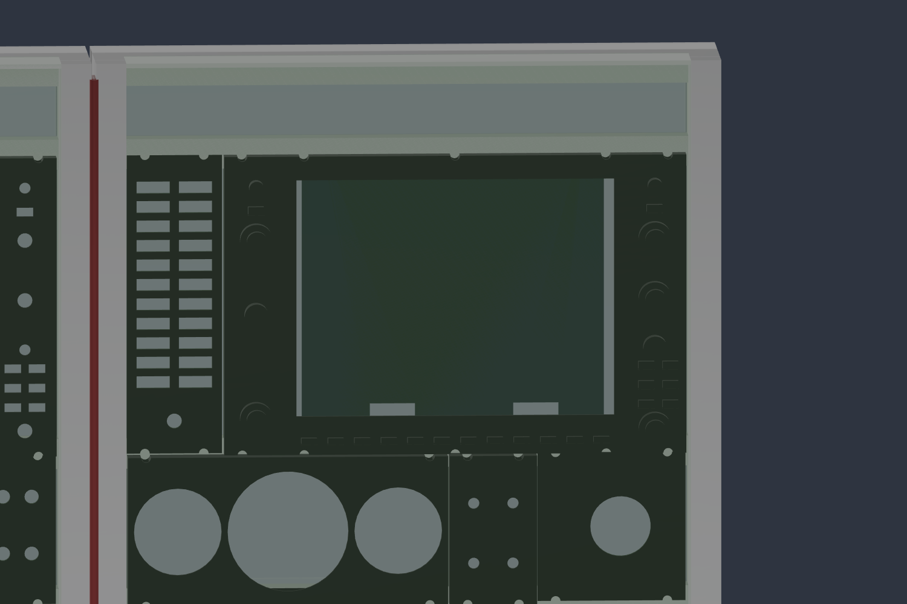
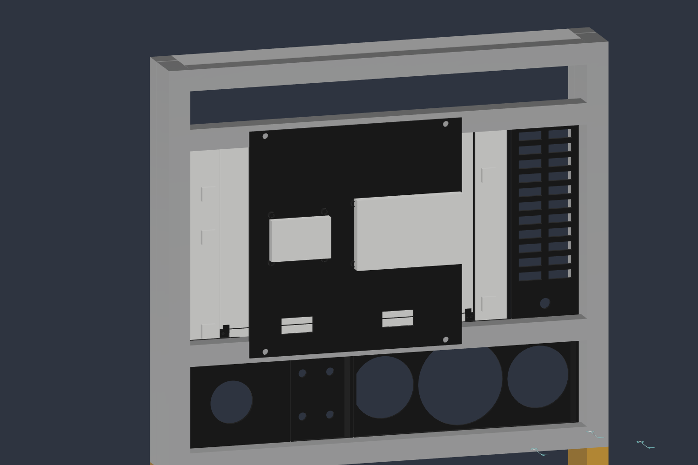

# MFD-1: G1000 GDU 1040 Assembly (build guide, iteration 1)

The Fusion component is **"MFD-1 GDU 1040 assembly"**, inside *Right half* in the design "Folding Cockpit Case - C172". It's built by `fusion/build_gdu1040.py`, so the same component can be reused for the PFD.
Purchased parts are modeled as hidden `REF` bodies (turn them on to see the packaging). The one-piece outsourced bezel is the hidden `OUTSOURCE` body.

## How it goes together (front to back)
| Layer | Part | Fastening |
|---|---|---|
| Face (15 mm deep shell) | Bezel: 3 printed pieces, or 1 outsourced piece | Each piece clamps to the rails on its own (M5 + 15 mm washer in the half-hole edge notches). Pieces come off independently for service |
| Knobs / caps | 5 dual knob sets, 4 single knobs, 20 key caps | Caps are captive: the flange sits behind the face, and the cap rides on its tact switch |
| LCD | AUO G104XVN01.0 class, against the back of the face | 4 printed clips (2 top, 2 bottom) on M2.5 heat-set bosses |
| Key/encoder PCBs | Left column, right column, softkey strip (all 1.6 mm, switches facing forward) | 6 M2.5 heat-set bosses; dual encoders also nut-mount through the face |
| Rail plane | Mounting flanges (3 mm) | Panel-plane standard |
| Behind the rails | Printed electronics tray (200 x 210 x 3) carrying the LVDS/HDMI driver board and the Arduino Mega 2560 Pro | 4 x M5 into rail T-nuts on the back of the rails; boards on 8 M3 heat-set standoffs. Two cable pass-throughs |

Fit checks in Fusion:
* Nothing collides: LCD, clips, PCBs, switches, encoders, key caps, knobs, tray, boards, rails and covers.
* The only "overlap" is the dual encoders passing through their PCB cutouts, which is intended.
* The case still folds closed with the full MFD installed. Knob tops sit 33.5 mm proud, inside the 40 mm budget.

## Purchased parts (per GDU 1040)
| Part | Qty | Spec / source notes |
|---|---|---|
| LCD panel | 1 | **AUO G104XVN01.0**, 10.4 in 1024x768, LED backlight, LVDS. Outline 238.6 x 175.8 x 6.5–6.7 mm, active area 210.4 x 157.8 (per Unisystem / Robotshop listings). Any substitute must be **≤ 238.6 x 175.8 x 7 mm** |
| LVDS→HDMI controller board kit for that panel | 1 | Buy as a matched kit (board + LVDS cable + backlight inverter/LED driver + key board). About 100 x 65 x 15 board footprint assumed; check the tray standoff pattern on arrival |
| 12 V 2 A supply (or tap the case 12 V 5 A rail) | 1 | Backlight + board |
| Dual concentric encoder with push | 5 | **PropWash Simulation dual concentric encoder kit** (Tindie, about $17, includes breakout PCB, nut, washer and knobs). Premium alternative: **Elma E37-VT6330-1**. Bezel hole is 9.5 mm; open it up if your encoder's bushing is larger |
| EC11 encoder with push, 20 mm shaft | 3 | NAV VOL, COM VOL, HDG (PCB-mounted, M7 bushing through the face) |
| ALPS RKJXT1F42001 (4-way joystick + encoder + push) | 1 | RANGE/PAN, as used in the open-source PA-28 G1000 build |
| Tact switch, Omron B3F-1000 class (6x6x4.3 mm, about 1M cycles) | 20 | 12 softkeys, 6 FMS keys, 2 frequency flip keys. Genuine Omron for the "pressed a lot" keys |
| Arduino Mega 2560 Pro (Mini) | 1 | MobiFlight firmware. About 61 inputs used (5 x 5 dual-encoder pins, 3 x 3 EC11, 7 joystick, 20 keys) |
| PCBs: left column 30 x 194, right column 30 x 194, softkey strip 222 x 13 | 1 set | Not laid out yet. Perfboard works for a first build; KiCad boards to JLCPCB are the next step |
| HDMI cable to PC, USB cable for the Mega | 1 each | |

## Mounting hardware (per GDU 1040)
| Item | Qty | Where |
|---|---|---|
| M2.5 brass heat-set insert (OD about 3.5, L 4) | 10 | 4 LCD-clip bosses + 6 PCB bosses (bores are 3.3 mm) |
| M2.5 x 6 pan head screw | 10 | Clips and PCBs |
| M3 brass heat-set insert (OD about 4.2, L 4) | 8 | Tray standoffs (bores 4.0 mm) |
| M3 x 6 pan head screw | 8 | Driver board + Mega |
| M5 x 10 button head + 15 mm washer + drop-in T-nut | 10 | Bezel edge clamps (shared between neighboring pieces) |
| M5 x 8 button head + drop-in T-nut | 4 | Tray to the rail backs |
| 2 mm dowel pins, 10 mm long, or epoxy (optional) | 4 | Align bezel seams if you want the pieces bonded |
| Small cable ties / adhesive mounts | 6 | LVDS and ribbon cables through the pass-throughs |

## Printing on the Bambu A1 (PETG, black)
| Part | File (`prints/MFD-1/A1_PETG/`) | Qty | Orientation and settings |
|---|---|---|---|
| Bezel left column (33 x 199 x 15) | MFD-1_bezel_left_column.stl | 1 | **Face down** on smooth or textured PEI, no supports (the cavity opens to the back), 0.16 mm layers, 4 walls, 25% gyroid |
| Bezel display frame (240 x 199 x 15) | MFD-1_bezel_display_frame.stl | 1 | Face down, no supports, brim off, 0.16 mm layers. Fits the 256 bed with 8 mm to spare |
| Bezel right column | MFD-1_bezel_right_column.stl | 1 | As left |
| LCD clips | LCD_clip_top.stl / LCD_clip_bottom.stl | 2 + 2 | Flat, 100% infill |
| Key caps (FMS / flip) | key_cap.stl | 8 | **Flange down**, 0.08–0.12 mm layers, 100% infill |
| Softkey caps | softkey_cap.stl | 12 | Flange down, 0.08–0.12 mm layers, 100% infill |
| Dual knob outer / inner | knob_outer_dual.stl / knob_inner_dual.stl | 5 / 5 | Upright, 0.12 mm. **Shapes are placeholders**: the shaft bores get set after measuring the encoders (the PropWash kit includes usable knobs) |
| Single / small knobs | knob_single.stl / knob_small_VOL.stl | 2 / 2 | Upright, 0.12 mm (same bore note) |
| Electronics tray | electronics_tray.stl | 1 | Flat, standoffs up, 3 walls, 20% |

Install heat-set inserts with a soldering iron at about 230 °C.

## Outsourced high-quality option (heavily used parts)
Files are in `prints/MFD-1/outsource/`:
* `MFD-1_bezel_one-piece.stl`: no seams, 306 x 199 x 15.
* `MFD-1_GDU1040_assembly.step`: whole component, for quoting.
* Caps, knobs and clips.

| Part | Recommended process / material | Why |
|---|---|---|
| Bezel (one piece) | **MJF PA12 (nylon), dyed black** (JLC3DP, PCBWay, Craftcloud) | Tough, matte, no layer lines, handles screw clamping and repeated button loads. Labels then go on as a sticker, or ask for UV printing |
| Key caps + softkey caps | **SLA tough/ABS-like resin, black** (e.g. JLC3DP 8001/Black resin), or MJF PA12 | Crisp edges, smooth feel, good wear for constant pressing |
| Knobs | SLA tough resin, or MJF PA12 | Knurl detail and tight bores |
| LCD clips, tray | Keep on the A1 (PETG) | Hidden, so no benefit from outsourcing |

When ordering:
* Ask for **±0.1 mm** tolerance on the key/softkey holes and caps (0.3 mm clearance per side is modeled).
* Check the minimum wall: 2.5 mm face and 3 mm bosses are fine for MJF and SLA.

## Assembly order
1. Press the heat-set inserts into the bezel bosses and tray standoffs.
2. Drop the key caps into the face holes from the back (flange behind the face).
3. Fit the LCD face-first into the cavity and clip it with the 4 clips.
4. Mount the softkey strip PCB, then the two column PCBs, with switches lined up under the caps. Nut-mount the dual encoders through the face. Fit the EC11s and the joystick on the column PCBs.
5. Screw the driver board and the Mega to the tray. Bolt the tray to the back of the rails. Route the LVDS cable and PCB ribbons through the pass-throughs.
6. Clamp the three bezel pieces to the rails (edge notches, M5 + washers). Fit the knobs.
7. Flash MobiFlight to the Mega, map the inputs, and set the MSFS MFD pop-out to the HDMI display.

## Open items
* PCB layouts (KiCad)
* Final knob bores after measuring the encoders
* Exact driver-board hole pattern for the tray
* The PFD will get the same assembly next (only its host and position change)
